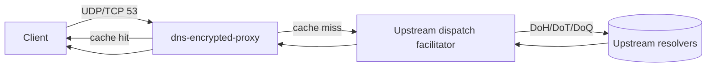
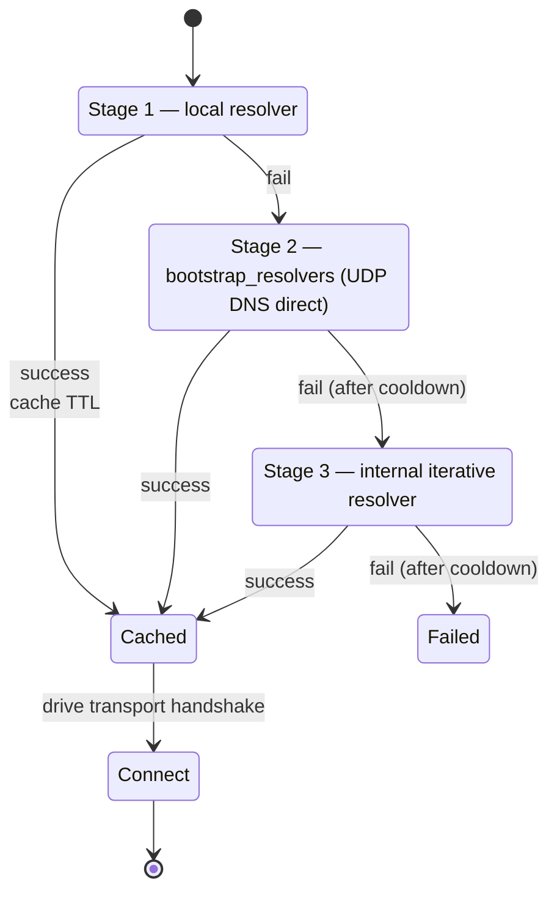
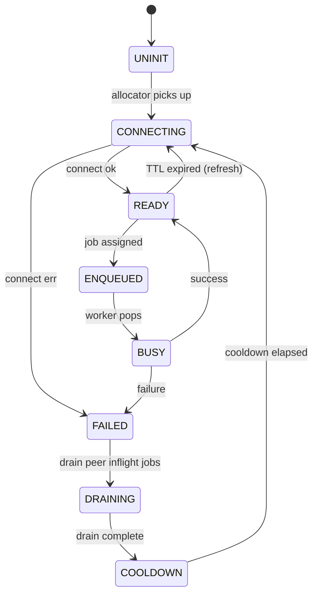

# dns-encrypted-proxy — Operations Manual

This is the engineering-grade reference for operating dns-encrypted-proxy. The README covers what it is and how to start it; the manual covers how it actually behaves once it's running, what every dial does, and how to diagnose it when it doesn't.

---

## 1. What it does

dns-encrypted-proxy is a forward DNS proxy. It listens on UDP/53 and TCP/53 for classic plaintext DNS, looks up answers in a local cache, and on cache miss forwards the question to one or more encrypted upstream resolvers (DoH, DoT, or DoQ). Responses are cached by canonical question key, the response transaction ID is rewritten to match the client's, and the answer goes back over whichever transport the client used.



Three transports are wired up. DoH is enabled by default; DoT is enabled by default; DoQ is opt-in (build flag) and currently labelled experimental.

---

## 2. Build matrix

The default Release build is what production runs. Other variants exist for specific concerns.

The build is a single Makefile; one variant per invocation, selected with `BUILD=`.

| Variant | Invocation | Purpose |
|---|---|---|
| Release | `make BUILD=release` (default) | Production. `-O3 -flto`, section GC, hardened. |
| Debug | `make BUILD=debug` | `-Og -g`, useful with gdb. |
| ASAN | `make BUILD=asan` | AddressSanitizer for memory bugs. |
| Coverage | `make coverage` | gcov instrumentation; runs the suite and gates on line coverage. |
| Analyze | `make analyze` | `gcc -fanalyzer` and `-fstack-usage` on production sources, then cppcheck, the stack limit and clang-tidy. |

Per-protocol toggles: `DOH=0|1`, `DOT=0|1`, `DOQ=0|1`. At least one must be on.

Other knobs: `C_LOG_PATH` (c-log checkout, default `../c-log`), `WERROR=0` (drop
`-Werror`, for toolchains newer than CI's), `OBJ_DIR`/`BIN_DIR` (override the
output directories), `STACK_USAGE_LIMIT`, `COVERAGE_LINE_THRESHOLD`.

Objects go to `build/<variant>/`; ready-to-run binaries land in `build/bin/`
regardless of variant, so the last build wins. Changing a toggle or variant
inside one object directory triggers a rebuild: every object depends on a
`.flags` file holding the full compile line.

---

## 3. Configuration

Config is read from a file (TOML/INI-style `key = value`) at startup. Lookup order:

1. Path passed as the only positional arg: `dns-encrypted-proxy /etc/proxy.conf`
2. `DNS_ENCRYPTED_PROXY_CONFIG` env var
3. `dns-encrypted-proxy.conf` in the current working directory

Every key has an env-var override (uppercased, see column 4 below). Env vars win over file values.

### 3.1 Listener

| Key | Default | Unit | Env override | Notes |
|---|---|---|---|---|
| `listen_addr` | `0.0.0.0` | IPv4 | `LISTEN_ADDR` | Bind address. |
| `listen_port` | `53` | port | `LISTEN_PORT` | Privileged ports need `cap_net_bind_service` or root. |
| `udp_workers` | `8` | count | `UDP_WORKERS` | Threads that resolve queries read off the UDP socket. The reader hands each datagram to one of them, so a slow query no longer blocks the ones behind it. `0` resolves inline on the reader thread (the pre-0.1.3 behavior); capped at 64. |
| `udp_queue_capacity` | `256` | count | `UDP_QUEUE_CAPACITY` | Datagrams that may wait for a free worker. Beyond it queries are shed and counted in `dns_encrypted_proxy_udp_queue_drops_total`; capped at 4096. |
| `tcp_idle_timeout_ms` | `10000` | ms | `TCP_IDLE_TIMEOUT_MS` | Idle TCP connections close after this. |
| `tcp_max_clients` | `256` | count | `TCP_MAX_CLIENTS` | Concurrent TCP connection cap. |
| `tcp_max_queries_per_conn` | `0` | count | `TCP_MAX_QUERIES_PER_CONN` | `0` = unlimited. |

### 3.2 Upstream

| Key | Default | Unit | Env override | Notes |
|---|---|---|---|---|
| `upstreams` | `https://dns.google/dns-query, https://cloudflare-dns.com/dns-query` | comma-separated URLs | `UPSTREAMS` | Schemes: `https://` (DoH), `tls://` (DoT), `quic://` (DoQ). |
| `upstream_timeout_ms` | `2500` | ms | `UPSTREAM_TIMEOUT_MS` | Per-query budget across all retries. |
| `upstream_pool_size` | `6` | count | `UPSTREAM_POOL_SIZE` | Worker slots per provider. |
| `max_inflight_doh` | `4` | count | `MAX_INFLIGHT_DOH` | Per-member concurrent DoH limit. |
| `max_inflight_dot` | `1` | count | `MAX_INFLIGHT_DOT` | Per-member concurrent DoT limit (TLS connection reuse means 1 is the right default). |
| `max_inflight_doq` | `1` | count | `MAX_INFLIGHT_DOQ` | Per-member concurrent DoQ limit. |
| `bootstrap_resolvers` | `8.8.8.8, 1.1.1.1` | comma-separated IPv4 | `BOOTSTRAP_RESOLVERS` | Stage-2 fallback recursive resolvers (see §4.2). |

### 3.3 Cache

| Key | Default | Unit | Env override | Notes |
|---|---|---|---|---|
| `cache_capacity` | `1024` | entries | `CACHE_CAPACITY` | Hash-bucketed LRU cache. |
| `failure_cache_ttl_seconds` | `30` | seconds | `FAILURE_CACHE_TTL_SECONDS` | RFC 2308 7.1 failure caching: a question that just failed answers SERVFAIL from cache for this long instead of re-burning the upstream budget. `0` disables; capped at `300` (the RFC maximum). Capacity is fixed at 512 entries. A failure that consumed the whole `upstream_timeout_ms` budget is *not* cached: running out of clock is evidence about the proxy, not about the name. |
| `hosts_a` | (empty) | comma-separated `name=ipv4` or `name:ipv4` | `HOSTS_A` | Local A-record overrides, returned with TTL 60. The proxy is authoritative for overridden names: every other query type (AAAA, HTTPS, TXT, ...) answers NODATA locally, standard hosts semantics; nothing for these names goes upstream. |

### 3.4 Metrics & logging

| Key | Default | Unit | Env override | Notes |
|---|---|---|---|---|
| `metrics_enabled` | `1` | bool | `METRICS_ENABLED` | `0` disables the metrics server. |
| `metrics_port` | `9090` | port | `METRICS_PORT` | HTTP endpoint, separate from DNS port. |
| `metrics_addr` | `0.0.0.0` | IPv4 | `METRICS_ADDR` | Bind address for the metrics listener. It has no auth, so on a multi-homed host (a router) bind it to an internal address. Rejected at config load if it is not an IPv4 literal. |
| `log_level` | `INFO` | DEBUG/INFO/WARN/ERROR | `LOG_LEVEL` | Lower is more verbose. |

---

## 4. Operating model

### 4.1 Query lifecycle

1. Client sends a DNS query over UDP or TCP. TCP connections get a thread each; UDP datagrams are read by a single reader thread and handed to the `udp_workers` pool, so one query that spends its whole budget cannot stall the ones behind it.
2. The proxy parses the question section and computes a canonical key (lowercased name + qtype + qclass + EDNS-relevant flags).
3. **`hosts_a` shortcut.** If the question is a single `A IN` record matching a local hosts override, return a synthesized response with TTL 60. No upstream traffic.
4. **Cache lookup.** On hit, the cached response is returned with TTLs aged down by elapsed time.
5. **Upstream dispatch.** On miss, a job is enqueued in the dispatch facilitator with the per-query deadline (`upstream_timeout_ms`).
6. **Worker execution.** A member worker picks up the job, performs the encrypted-DNS round trip, and pushes the result to the completed queue.
7. **Completion.** The completion thread updates member state (success / failure / drain), retries on the next provider if appropriate (subject to budget and attempts), and finalizes the job.
8. **Response shaping.** ID is rewritten to match the client's. UDP responses larger than the negotiated payload limit are returned with `TC=1` so the client retries over TCP.
9. **Cache store.** Cacheable responses (NOERROR with answers, NXDOMAIN, NODATA per RFC 2308) are stored with TTL = `min(answer TTLs)` floored and capped.

### 4.2 Three-stage upstream bootstrap

DNS over an encrypted transport requires resolving the upstream's hostname first — a chicken-and-egg problem. The proxy handles it in three stages, escalating only on failure of the previous one.



- **Stage 1** (`upstream_bootstrap_stage1_hydrate`): use the OS resolver via `getaddrinfo`. Caches the result with its own TTL. Invalidated on transport failure that smells DNS-related.
- **Stage 2** (`upstream_bootstrap_try_stage2`): direct UDP DNS query to each `bootstrap_resolvers` entry in order. Cooldown `UPSTREAM_STAGE3_RETRY_COOLDOWN_MS` (30s) between stage-2 retries to avoid hammering the operator-configured resolvers.
- **Stage 3** (`upstream_bootstrap_try_stage3`): the proxy's own iterative resolver walks from the root servers down. Used only when stage 2 also fails. Same cooldown applies.

Each stage transitions are visible via the `dns_encrypted_proxy_upstream_stage_fallback_total` and `dns_encrypted_proxy_upstream_stage_reason_total` counters (see §5.5).

**Budget reservation.** Stage 1 runs against a deadline shortened by `UPSTREAM_STAGE_FALLBACK_RESERVE_MS` (600 ms, never more than half of what is left), so a local resolver that hangs cannot spend the budget the later stages need. Without that reserve the stages were unreachable in exactly the situation they exist for: if `getaddrinfo` leads back through the proxy's own downstream, stage 1 stalls until the deadline and stages 2 and 3 log `budget_exhausted` and are skipped. Stage 2's UDP lookup is further capped at `UPSTREAM_STAGE2_QUERY_TIMEOUT_MS` (400 ms) so stage 3 and the retry still have room.

**Retry routing.** The attempt that follows a successful stage 2 or stage 3 skips the libc route *and* the stage-1 address cache (`UPSTREAM_ATTEMPT_SKIP_LOCAL_ROUTE`): both derive from the resolver that just failed, so dialing them again would spend the retry proving what the bootstrap already established.

**Member refresh.** A ready member re-checks the address it dials every `MEMBER_REFRESH_INTERVAL_MS`, staggered per slot so a provider's members never come due in the same pass. The check runs *in place*: the member keeps serving its current address and only a failed check unseats it. Dropping to `connecting` first meant that whenever the system resolver was slow, every member went unavailable together and queries died at their own deadline without a single upstream attempt. For the same reason the stage1 lookup runs outside the address-cache lock, and a caller that finds a lookup already in flight uses the last known address instead of queueing behind a blocking `getaddrinfo`.

### 4.3 Member state machine

A *member* is one worker slot for a specific upstream provider. The proxy keeps `upstream_pool_size` members per upstream and walks each through this state machine.



- `UNINIT` — slot exists but no resources yet.
- `CONNECTING` — allocator thread is performing the handshake (DoH curl handle setup, DoT TLS handshake, DoQ QUIC handshake).
- `READY` — handshake done; member can accept jobs.
- `ENQUEUED` — at least one job is on this member's queue.
- `BUSY` — worker thread is currently performing a round trip.
- `FAILED` — last operation failed; member is being torn down.
- `DRAINING` — completion thread is fast-failing this member's other inflight jobs (real bug fix: workers actively processing a job are skipped — see `inflight_drain_member`).
- `COOLDOWN` — `MEMBER_FAILURE_COOLDOWN_MS` (default in source) before the allocator re-tries.

Per-state counts are exported as `dns_encrypted_proxy_upstream_dispatch_members{state="..."}`.

### 4.4 Cache policy

- **Hash + LRU + admission.** Each shard is a fixed-bucket hash table with a per-shard LRU list. An admission filter (`admit_bits`) avoids one-hit-wonders polluting the cache.
- **Sharding.** Multiple shards reduce mutex contention; one mutex per shard, hash determines target.
- **TTL.** Stored TTL is the minimum of the response's answer TTLs, floored at 1s and capped at the cache's hard ceiling (defined in `cache.c`). Aged down on read.
- **Bounded sweeps.** Eviction walks at most a small fixed window per insert to keep the hot path predictable.
- **Stats.** `dns_encrypted_proxy_cache_{hits,misses,evictions,expirations,entries,bytes_in_use}` and `_capacity`.

### 4.5 Protocol selection (DoH HTTP version)

When `libcurl` is built with HTTP/3, DoH requests prefer h3, then h2, then h1.1. The proxy checks that at startup via `curl_version_info()` and logs `libcurl has no HTTP/3 backend; DoH attempt ladder starts at HTTP/2` when the backend is missing (Alpine's `libcurl` package is one such build). This matters for more than labelling: the ladder divides the per-server budget among the steps it plans to run, so counting a tier that cannot execute shrinks every attempt that can. A tier the runtime cannot speak is dropped from the ladder entirely.

Each attempt is handed the remaining budget minus `DOH_FALLBACK_RESERVE_MS` (300 ms) for each ladder step still behind it, capped at half the budget, and floored at `DOH_MIN_ATTEMPT_TIMEOUT_MS`. The failures that make laddering worthwhile (connection refused, TLS reject, unresolvable host) return in tens of milliseconds, so reserving a connect-sized allowance rather than an equal share gives the attempt most likely to answer nearly the whole budget.

The proxy actively probes upgrades and tracks per-upstream "forced tier" state with backoff so a flaky h3 path doesn't keep failing first on every query:

- On transport failure at a higher tier, the upstream is forced down (h3→h2 or h2→h1) for `DOH_UPGRADE_BACKOFF_BASE_MS` × `2^attempts` (capped at `DOH_UPGRADE_BACKOFF_MAX_MS`).
- A pin needs evidence about the *protocol*, not just a lower tier answering. h3 rides QUIC over UDP, so failing to connect at all counts against it (the blocked-UDP case, still subject to the consecutive-failure threshold). h2 and h1 share the same TCP and TLS path, so a pin out of h2 needs a failure that reached the peer or died in the handshake where ALPN is negotiated. Without that rule an h2 attempt failing on the libc route while h1 answered on the bootstrap route read as a protocol verdict, and cost h2 multiplexing on every query until the next upgrade probe.
- After backoff, an upgrade probe goes back to the higher tier. Probe outcomes are tracked separately in counters.
- The active forced tier is exported per-upstream as `dns_encrypted_proxy_upstream_doh_forced_http_tier{...} 0|1|2` (h3/h2/h1).

Test overrides, used by the test suite and not for production: `DNS_ENCRYPTED_PROXY_TEST_FORCE_HTTP1=1` forces h1.1 and collapses the ladder to that single tier, and `DNS_ENCRYPTED_PROXY_TEST_BOOTSTRAP_DNS_PORT` points stage 2 at a mock resolver on an unprivileged port.

---

## 5. Metrics reference

Endpoint: `GET /metrics` on `metrics_port`. Prometheus text format `0.0.4`. Health probes: `/healthz` (always-200 once `proxy_server_init` completes) and `/readyz` (200 once at least one member reaches `READY`).

### 5.1 Traffic

| Metric | Type | Labels | Notes |
|---|---|---|---|
| `dns_encrypted_proxy_queries_udp_total` | counter | — | Inbound UDP queries seen. |
| `dns_encrypted_proxy_queries_tcp_total` | counter | — | Inbound TCP queries (each query, not each connection). |
| `dns_encrypted_proxy_responses_total` | counter | — | Responses sent back to clients. |
| `dns_encrypted_proxy_responses_rcode_total` | counter | `rcode` | Response code histogram. |
| `dns_encrypted_proxy_truncated_sent_total` | counter | — | UDP responses with `TC=1`. |
| `dns_encrypted_proxy_servfail_sent_total` | counter | — | SERVFAIL responses (proxy-originated). For EDNS clients these carry an RFC 8914 EDE option: 23 (Network Error) when the upstream transport failed, 22 (No Reachable Authority) when the upstream was reachable but no answer arrived within budget. Upstream-originated SERVFAILs are relayed verbatim, including any upstream EDE. |

### 5.2 Cache

| Metric | Type | Notes |
|---|---|---|
| `dns_encrypted_proxy_cache_hits_total` | counter | |
| `dns_encrypted_proxy_cache_misses_total` | counter | |
| `dns_encrypted_proxy_failure_cache_hits_total` | counter | SERVFAILs answered from the RFC 2308 failure cache without an upstream attempt. |
| `dns_encrypted_proxy_udp_queue_drops_total` | counter | UDP queries shed because every worker was busy and the handoff queue was full. Clients retry, but a nonzero rate means the proxy is shedding load: raise `udp_workers`, or find what is holding queries open for their full budget. |
| `dns_encrypted_proxy_cache_evictions_total` | counter | LRU pressure events. |
| `dns_encrypted_proxy_cache_expirations_total` | counter | TTL-aged-out reads/sweeps. |
| `dns_encrypted_proxy_cache_entries` | gauge | Current entry count. |
| `dns_encrypted_proxy_cache_capacity` | gauge | Configured maximum. |
| `dns_encrypted_proxy_cache_bytes_in_use` | gauge | Total response bytes held. |

### 5.3 Upstream health

| Metric | Type | Labels | Notes |
|---|---|---|---|
| `dns_encrypted_proxy_upstream_success_total` | counter | — | Successful upstream queries. |
| `dns_encrypted_proxy_upstream_failures_total` | counter | — | Failed upstream queries (after retries). |
| `dns_encrypted_proxy_upstream_server_requests_total` | counter | `host`, `type` | Per-upstream requests attempted. |
| `dns_encrypted_proxy_upstream_server_failures_total` | counter | `host`, `type` | Per-upstream failures. |
| `dns_encrypted_proxy_upstream_server_healthy` | gauge | `host`, `type` | 1 healthy / 0 unhealthy. |
| `dns_encrypted_proxy_upstream_server_consecutive_failures` | gauge | `host`, `type` | Trips `0` on success. |
| `dns_encrypted_proxy_upstream_pool_capacity` | gauge | `type` | Per-protocol pool size. |
| `dns_encrypted_proxy_upstream_pool_in_use` | gauge | `type` | Active connections. |
| `dns_encrypted_proxy_upstream_pool_idle` | gauge | `type` | Available connections. |
| `dns_encrypted_proxy_upstream_connections_alive` | gauge | `type` | Established but maybe idle. |

### 5.4 DoH protocol behavior

| Metric | Type | Labels | Notes |
|---|---|---|---|
| `dns_encrypted_proxy_doh_http_responses_total` | counter | `http_version` | h3 / h2 / h1 / other. |
| `dns_encrypted_proxy_doh_protocol_downgrades_total` | counter | `from`, `to` | Forced downgrades on failure. |
| `dns_encrypted_proxy_doh_protocol_upgrade_probes_total` | counter | `result` | Upgrade probe outcome. |
| `dns_encrypted_proxy_upstream_doh_forced_http_tier` | gauge | `host` | Currently forced tier (0=h3, 1=h2, 2=h1). |
| `dns_encrypted_proxy_upstream_doh_upgrade_retry_remaining_milliseconds` | gauge | `host` | Time until next upgrade probe. |
| `dns_encrypted_proxy_upstream_doh_h3_consecutive_failures` | gauge | `upstream` | Consecutive h3 failures; any downgrade pin out of h3 engages at the threshold (3). |
| `dns_encrypted_proxy_upstream_doh_attempt_failures_total` | counter | `upstream`, `tier`, `class` | Per-attempt failures by protocol tier and failure class. |
| `dns_encrypted_proxy_upstream_doh_slow_retries_total` | counter | `upstream`, `result` | Full-remaining-budget retries after a timed-out attempt whose request reached the upstream (slow answer, not broken transport). `result` is attempt / success. |
| `dns_encrypted_proxy_doh_pool_wait_timeouts_total` | counter | none | Attempts abandoned because no handle in the DoH pool came free inside the query's own deadline. Local congestion, not an upstream fault: nothing is sent and the server's health is untouched. A nonzero rate means `upstream_pool_size` is too small for the offered load, or upstream latency is holding handles too long. |
| `dns_encrypted_proxy_doh_connection_recycles_total` | counter | none | DoH pool handles replaced after a request on their connection went out and no answer came back (see 6.5). A few per day is a slow upstream costing one extra handshake. A burst across every handle means the path dropped connections without closing them, typically a NAT reset upstream. |

### 5.5 Bootstrap stages

| Metric | Type | Labels | Notes |
|---|---|---|---|
| `dns_encrypted_proxy_upstream_stage` | gauge | `host`, `stage` | Active stage per upstream (1/2/3). |
| `dns_encrypted_proxy_upstream_stage_fallback_total` | counter | `from`, `to` | Stage transition events. |
| `dns_encrypted_proxy_upstream_stage_reason_total` | counter | `stage`, `reason` | Why each fallback fired (network/dns/transport/cooldown/other). |

### 5.6 Dispatch facilitator

| Metric | Type | Labels | Notes |
|---|---|---|---|
| `dns_encrypted_proxy_upstream_dispatch_queue_depth` | gauge | `queue` | submit / work / completed depths. |
| `dns_encrypted_proxy_upstream_dispatch_members` | gauge | `state` | Members in each state (§4.3). |
| `dns_encrypted_proxy_upstream_dispatch_inflight` | gauge | `provider` | Inflight job count per provider. |
| `dns_encrypted_proxy_upstream_dispatch_penalty` | gauge | `provider` | Routing penalty applied to flaky providers. |
| `dns_encrypted_proxy_upstream_dispatch_events_total` | counter | `event` | requeue / drop / budget_exhausted / reconnect (SIGHUP requests carried out, see 6.4). |
| `dns_encrypted_proxy_upstream_dispatch_queue_wait_milliseconds_avg` | gauge | — | Rolling avg job-queue wait. |
| `dns_encrypted_proxy_upstream_dispatch_queue_wait_milliseconds_max` | gauge | — | Worst observed wait since boot. |
| `dns_encrypted_proxy_upstream_dispatch_queue_wait_bucket` | counter | `le` | Histogram (1, 5, 10, 25, 50, 100, 250, 500, 1000, +Inf ms). |

### 5.7 TCP & process

| Metric | Type | Notes |
|---|---|---|
| `dns_encrypted_proxy_tcp_connections_total` | counter | Accepted lifetime count. |
| `dns_encrypted_proxy_tcp_connections_active` | gauge | Currently held. |
| `dns_encrypted_proxy_tcp_connections_rejected_total` | counter | Bumped against `tcp_max_clients` cap. |
| `dns_encrypted_proxy_metrics_http_requests_total` | counter | Hits on the metrics server itself. |
| `dns_encrypted_proxy_metrics_http_responses_total` | counter | Status-coded responses. |
| `dns_encrypted_proxy_metrics_http_in_flight` | gauge | Concurrent metrics scrapes. |
| `dns_encrypted_proxy_process_cpu_percent` | gauge | RSS-based estimate. |
| `dns_encrypted_proxy_process_memory_rss_bytes` | gauge | From /proc/self/status. |
| `dns_encrypted_proxy_uptime_seconds` | counter | Since `proxy_server_init`. |
| `dns_encrypted_proxy_internal_errors_total` | counter | Sum of internal error events (one row per `reason` label). |

---

## 6. Deployment

### 6.1 Capabilities

Binding to UDP/TCP `:53` requires either `root` or the binary having `cap_net_bind_service`:

```bash
sudo setcap 'cap_net_bind_service=+ep' /path/to/dns-encrypted-proxy
```

The metrics port (default `9090`) is unprivileged.

### 6.2 Docker

The shipped Dockerfile builds with DoH+DoT (no DoQ) for size/portability. Default config path inside the container is `/app/config/dns-encrypted-proxy.conf` via the `DNS_ENCRYPTED_PROXY_CONFIG` env var. Mount your own config there to override.

```bash
docker run --rm -p 53:53/udp -p 53:53/tcp -p 9090:9090 \
  -v "$(pwd)/dns-encrypted-proxy.conf:/app/config/dns-encrypted-proxy.conf:ro" \
  dns-encrypted-proxy:dev
```

The container listens on `:53` inside; the host port mapping needs to be unprivileged on the host or run as root.

### 6.3 systemd and the Debian package

CI builds a Debian trixie amd64 package: the release binary, tested on
trixie, plus a hardened unit. The package is distributed as a job artifact,
not through a registry:

| Pipeline | Job | Artifact | Version | Kept |
|---|---|---|---|---|
| Tag `vX.Y.Z` (must match `release_version`) | `deb_release` | `build/deb/dns-encrypted-proxy_X.Y.Z_amd64.deb` | `X.Y.Z` | Never expires |
| Anything else | `deb` | `build/deb/dns-encrypted-proxy_<semver>~dev<iid>.g<sha>_amd64.deb` | sorts below the release | 1 month |

Another project's CI fetches a release with its own job token, once that
project is on this project's CI/CD job token allowlist (the router,
`vifair22/router`, is):

```bash
curl --fail --header "JOB-TOKEN: $CI_JOB_TOKEN" -o dns-encrypted-proxy.deb \
  "https://git.airies.net/api/v4/projects/215/jobs/artifacts/v0.2.0/raw/build/deb/dns-encrypted-proxy_0.2.0_amd64.deb?job=deb_release"
```

| Path | What |
|---|---|
| `/usr/sbin/dns-encrypted-proxy` | Binary (DoH + DoT, no DoQ). |
| `/etc/dns-encrypted-proxy/dns-encrypted-proxy.conf` | Config, a dpkg conffile (local edits survive upgrades). |
| `/usr/lib/systemd/system/dns-encrypted-proxy.service` | Unit (`packaging/dns-encrypted-proxy.service`). |
| `/usr/share/doc/dns-encrypted-proxy/` | README, this manual, copyright. |

Depends are derived by `dpkg-shlibdeps` from the binary (libc6, libcurl4t64,
libssl3t64) plus `procps` for the `/bin/kill` that `ExecReload` runs.

The package installs the unit **disabled** and its maintainer scripts never
enable or start it; `systemctl enable --now dns-encrypted-proxy` is the
admin's call. They do run `daemon-reload`, `try-restart` an already-running
instance on upgrade (so it does not keep executing the replaced binary), and
stop it on removal.

The unit runs as `Type=notify` with `DynamicUser=yes`, only
`CAP_NET_BIND_SERVICE`, and a strict sandbox (`ProtectSystem=strict`,
`SystemCallFilter=@system-service`, `MemoryDenyWriteExecute`, address
families limited to `AF_INET AF_INET6 AF_UNIX AF_NETLINK`).
`ExecReload=/bin/kill -HUP $MAINPID` maps `systemctl reload` to the
reconnect in 6.4. The proxy speaks the `sd_notify` protocol itself (no
libsystemd).

On a router whose system resolver forwards to this proxy, upstream hostnames
cannot be resolved through the system resolver at cold start; the stage2
`bootstrap_resolvers` cover that, so keep them pointed at resolvers reachable
without this proxy.

What it sends to `$NOTIFY_SOCKET`:

| When | Datagram |
|---|---|
| UDP and TCP listeners bound, metrics listener up, serving threads started | `READY=1` + `STATUS=Serving DNS on <addr>:<port>` |
| SIGTERM or SIGINT received (sent from the handler) | `STOPPING=1` |

`READY=1` deliberately does not wait for an upstream. A host that boots with
its WAN down would otherwise hold the unit in `activating` until
`TimeoutStartSec` and restart-loop; the proxy is useful as soon as it can
answer (cache, `hosts_a`, SERVFAIL fast). Upstream health is what `/readyz`
reports.

`NOTIFY_SOCKET` may be a filesystem path or an `@abstract` name. Anything else
(for example a `vsock:` address) fails startup with an error naming the
variable rather than surfacing later as a start timeout. A failed send after
startup is logged at WARN and does not stop the proxy. Outside systemd the
variable is unset and all of this is a no-op. `AF_UNIX` must stay in
`RestrictAddressFamilies` for the notification to get out.

### 6.4 Signals and route changes

| Signal | Effect |
|---|---|
| `SIGTERM`, `SIGINT` | Clean shutdown; `STOPPING=1` to systemd. |
| `SIGHUP` | Drop and redial every pooled upstream connection. The process keeps running and keeps serving. |

`SIGHUP` exists for a host whose default route moves, typically a router's
WAN failover daemon. Pooled DoH and DoT connections are bound to the old
path; without a nudge each one has to time out on its own before the proxy
redials, which reads as a stall of several upstream timeouts after every
failover. A systemd unit wires it as `ExecReload=/bin/kill -HUP $MAINPID`, so
`systemctl reload dns-encrypted-proxy` is the operator spelling.

What one `SIGHUP` does:

1. The handler bumps an atomic generation counter and returns (it is
   async-signal-safe; nothing else runs in signal context).
2. Within about 10 ms the dispatch allocator thread sees the new generation
   and carries it out:
   - each live transport marks its pool stale. DoH replaces each curl easy
     handle, which owns its connection cache; DoT closes each TLS connection.
     This happens on the slot's next checkout, so a connection a worker is
     using at that moment is never touched from another thread; that query
     finishes or times out on the old path, and its next one dials fresh.
     DoQ opens a QUIC connection per query and has nothing pooled.
   - per-server penalties earned on the old path are cleared: health
     backoff, transport retry suppression, the stage2 bootstrap cooldown and
     any DoH HTTP-version pin (re-learned on the new path).
   - members in cooldown or failed retry immediately; ready members re-verify
     their route in place on the normal slot stagger and keep serving
     meanwhile.
3. `dispatch_events_total{event="reconnect"}` increments and an INFO line
   (`Upstream reconnect requested`) is logged.

Deliberately kept: the resolved upstream addresses (stage1 cache and stage2
bootstrap addresses). Provider IPs do not depend on which WAN is up, and on a
router the system resolver used to re-resolve them may itself be a dnsmasq
that forwards to this proxy, which would turn a reconnect into a bootstrap
loop. Several `SIGHUP`s in quick succession coalesce into as many allocator
passes as it observes, each cheap.

A `SIGHUP` that arrives before the upstream client exists (early in startup)
is ignored rather than terminating the process.

### 6.5 Connections that die silently

A pooled connection can die without either end closing it. The usual cause
is NAT state flushed somewhere on the path: a router or modem reboot, or a
carrier-grade NAT reset. Packets on the old connection are dropped from then
on, and no RST ever comes back. The kernel only gives up on such a
connection after `tcp_retries2` worth of retransmits, about a quarter of an
hour. Over HTTP/2, libcurl keeps a connection when one of its streams times
out and puts the next request on it, so a single dead connection would
swallow every query its handle carries for that whole time, bootstrap-IP
attempts included.

The proxy treats an unanswered request as possible evidence of a dead
connection:

- When a DoH request was sent and its attempt timed out, the slot's curl
  handle is replaced before the slow-response retry. The retry and every
  later query on that slot dial a fresh connection. A genuinely slow upstream
  loses one TLS handshake to this. Replacing the handle also closes its
  healthy connections to other upstreams, which are redialled on next use.
  Each replacement increments `doh_connection_recycles_total` and logs
  `DoH connection redialled after an unanswered request` at INFO.
- DoH sockets carry `TCP_USER_TIMEOUT` of 10 s, so the kernel fails a
  connection whose sent data goes unacknowledged that long. Keepalive starts
  probing after 30 s idle, every 10 s, so an idle pooled connection that has
  died is dropped within about 40 s, before a query is sent down it.
- DoT closes its connection on any read timeout and needs neither. DoQ opens
  a connection per query.

After a NAT reset each pool slot therefore costs one query attempt slice and
recovers within that query's own budget, without a `SIGHUP`. `SIGHUP` is
still the right call when the host knows the route changed (6.4): it redials
everything at once instead of one slot at a time.

---

## 7. Troubleshooting

### 7.1 "All queries SERVFAIL"

1. `curl http://localhost:9090/readyz` — does at least one member report ready?
2. Check `dns_encrypted_proxy_upstream_stage{host="..."}` per upstream. Stuck on stage 2 or 3 means stage 1 (system DNS) is broken — check `/etc/resolv.conf` and that `bootstrap_resolvers` is reachable.
3. Check `dns_encrypted_proxy_upstream_server_consecutive_failures`. Non-zero means the upstream is rejecting / TLS failing.
4. Bump `log_level` to `DEBUG` and look for `Upstream stage event:` lines — they're verbose but explicit about which transport stage failed and why.
5. `Upstream stage event: ... action=skipped reason=budget_exhausted` on every failure means queries are arriving at the transport with no time left, not that the upstream is broken. Check `dns_encrypted_proxy_doh_pool_wait_timeouts_total` and `dns_encrypted_proxy_upstream_dispatch_queue_wait_milliseconds_max` for the congestion, and raise `upstream_pool_size` or `upstream_timeout_ms`.
6. Every DoH attempt logging `reason=timeout ... sent=1`, while a direct
   `curl` to the provider from the same network namespace answers at once,
   is the silent-dead-connection pattern (6.5). Since 0.2.1 the proxy recovers
   from this by itself within one query per pool slot, and
   `doh_connection_recycles_total` jumps. On older versions send `SIGHUP`.
   `ss -tnoi state established` showing upstream sockets with a large
   `Send-Q` and a high `backoff` confirms it.
7. A containerised proxy whose own `resolv.conf` points at a downstream resolver that forwards back to the proxy has no working stage 1 by construction. Give the container a resolver outside that loop (`--dns`) rather than relying on the bootstrap ladder to unwind it on every cold start.

### 7.2 "DoH is slow / timing out"

1. `dns_encrypted_proxy_upstream_doh_forced_http_tier{host="..."}` — if it's `2` (h1) the proxy gave up on h2/h3 due to repeated failures. `dns_encrypted_proxy_upstream_doh_upgrade_retry_remaining_milliseconds` shows when the next upgrade probe will fire.
2. Check the libcurl version's HTTP/3 support: `curl -V` looking for `HTTP3` in features. Without it the proxy runs h2/h1 only and says so once at startup. `dns_encrypted_proxy_doh_http_responses_total{version="h3"}` staying at 0 while h2 climbs is the same signal from the metrics side.
3. `dns_encrypted_proxy_upstream_dispatch_queue_wait_milliseconds_max` — high values mean dispatch is queuing rather than executing; raise `upstream_pool_size` or `max_inflight_doh`.

### 7.3 "UDP is slow but TCP is fine"

1. `dns_encrypted_proxy_udp_queue_drops_total` rising means the worker pool is saturated: raise `udp_workers`, or find what is holding queries open for their whole budget.
2. Clients falling back to TCP en masse (`queries_tcp_total` outrunning `queries_udp_total`) is the classic signature of UDP answers arriving late. Check `upstream_dispatch_queue_wait_milliseconds_max` and `doh_pool_wait_timeouts_total` before suspecting the network.

### 7.4 "Cache isn't helping"

1. `dns_encrypted_proxy_cache_hits_total` / `(hits + misses)` is your hit ratio. Production ratios above 40% are typical for residential traffic, lower for forwarder-of-forwarders deployments.
2. `dns_encrypted_proxy_cache_evictions_total` rising fast → bump `cache_capacity`.
3. `dns_encrypted_proxy_cache_expirations_total` rising fast with low hits → upstream TTLs are too short for the working set; not much you can do beyond capacity.

### 7.5 "Process keeps growing in memory"

`dns_encrypted_proxy_process_memory_rss_bytes` should stabilize. If it grows monotonically:

1. Compare with `dns_encrypted_proxy_cache_bytes_in_use` — usually accounts for most of it.
2. Run an ASAN build (`-DENABLE_ASAN=ON`) and reproduce. ASAN catches leaks at exit.

### 7.6 "Tests pass but I don't trust them"

The reverse-engineering moves: build with ASAN (`build/asan`), run `ctest --test-dir build/asan`. If green, run full Alpine matrix locally:

```bash
sh tools/run_ci_tests_docker.sh
```

This is the same script CI runs — it builds all 7 DoH/DoT/DoQ combinations and runs tests against each.

---

## 8. Source layout

| File | Purpose |
|---|---|
| `src/main.c` | Argv parsing, signal handlers, lifecycle. |
| `src/config.c` | Config file + env var loader. |
| `src/dns_server.c` | UDP/TCP listeners, per-query state machine, response shaping. |
| `src/dns_message.c` | DNS wire-format helpers (parse questions, validate responses, age TTLs). |
| `src/cache.c` | Sharded TTL-aware LRU cache. |
| `src/upstream.c` | Upstream client orchestrator, cross-protocol fallback. |
| `src/upstream_dispatch.c` | Allocator, dispatcher, completion threads; the per-member state machine. |
| `src/upstream_bootstrap.c` | 3-stage bootstrap. |
| `src/upstream_doh.c` / `.h` | libcurl-based DoH transport. |
| `src/upstream_dot.c` / `.h` | OpenSSL-based DoT transport. |
| `src/upstream_doq.c` / `.h` | DoQ frontend, delegates to `upstream_doq_ngtcp2`. |
| `src/upstream_doq_ngtcp2.c` / `.h` | ngtcp2-based DoQ transport. |
| `src/iterative_resolver.c` | Stage-3 resolver (root → TLD → authoritative). |
| `src/metrics.c` | Prometheus exposition + `/healthz` / `/readyz`. |
| `src/sd_notify.c` / `.h` | systemd readiness notification over `$NOTIFY_SOCKET`. |
| `src/logger.c` | Thin wrapper over the c-log dependency. |

Dependencies that have to be present at build time:

- `c-log` (header-only, the project's own structured logger; path via `C_LOG_PATH=`, default `../c-log`).
- `libcurl` if `DOH=1`.
- `openssl` if `DOT=1` or `DOQ=1`.
- `ngtcp2` + an ngtcp2 OpenSSL-family crypto module if `DOQ=1`.
- `cmocka` for the `tests` and `test` targets.
- `gcovr` for the `coverage` target.
- `clang-tidy` and `cppcheck` for the `lint` and `cppcheck` targets respectively.
